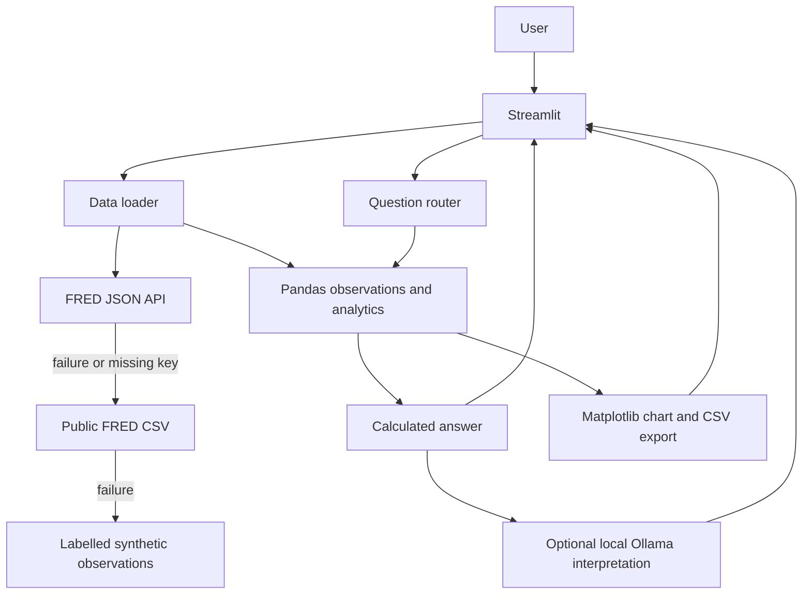

# GDP and Core CPI conversational application

## Architecture

## Implementation and methodology

The Python application uses Streamlit for its dashboard and session chat history,
Requests for retrieval, Pandas for analysis, Matplotlib for downloadable plots,
and Ollama for optional language generation. The question router selects fixed
calculations; the LLM does not execute Python. Calculated answers remain visible
alongside generated interpretations, which are not guaranteed to be accurate.

GDP year-over-year growth is 100 × (GDP / GDP four quarters earlier − 1).
Core CPI inflation is 100 × (index / index twelve months earlier − 1).
GDP refers to nominal output, not inflation-adjusted real output. Quarterly
comparison uses the mean of three monthly year-over-year CPI rates, excluding
incomplete quarters. Pearson correlation describes contemporaneous association
and cannot establish causation. Latest observations can refer to different periods.
Data may be revised by the provider; this application does not track vintages.

## Reproduction and deliverables

Follow README.md to launch the application. Use the seven questions in
personal/instruction.txt. Download the chart and comparison CSV from the dashboard.
The architecture above is renderable Mermaid source. Automated regression tests
cover all seven required question forms as well as basic analytics.

## Findings and limitations

Synthetic observations demonstrate the workflow only; they provide no evidence
about the U.S. economy. For real findings, load FRED successfully, record the source
label and observation window, export the CSV/chart, and report the calculated
GDP and inflation endpoints and correlation. Real-data findings and live Ollama
behavior have not yet been independently verified in this environment.

Routing supports the assignment's question forms but is not a general economic
reasoner. Chat history is displayed but is not supplied to the router: questions
must specify the subject explicitly. Available history limits requested windows.
Missing observations can affect row-based lag calculations; a future extension
should validate a complete calendar before computing rates. LLM text should be
checked against the visible calculated answer before inclusion in a submission.
